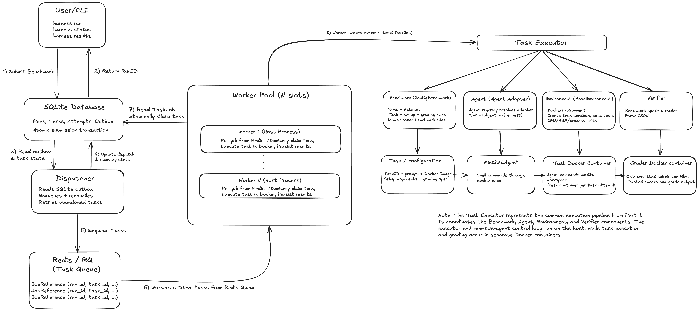

# Agentic Harness: Setup and Architecture

A unified CLI for evaluating agents against configurable benchmarks. The harness supports isolated Docker task environments, asynchronous execution with Redis/RQ workers, and persistent run results in SQLite.

## Setup and Running

### Prerequisites

- **Python 3.11+** and [uv](https://docs.astral.sh/uv/)
- **Docker** with Docker Compose
- **Make** and **tmux**
- API credentials for a supported model provider (e.g., OpenRouter)

### 1. Install Dependencies

From the project root:

```bash
make install
```

This creates the virtual environment and installs the harness, testing dependencies, and mini-swe-agent.

The mini-swe-agent Git submodule does not need to be initialized when using the PyPI installation.

### 2. Configure API Credentials

This example uses OpenRouter. Configure the API key and model in the same terminal from which you launch the harness:

```bash
printf "OpenRouter API key: "
read -rs OPENROUTER_API_KEY
echo
export OPENROUTER_API_KEY

export MSWEA_MODEL_NAME="openrouter/anthropic/claude-sonnet-5"
```

The key is entered without displaying it or adding it to shell history. Choose a different model name if needed.

### 3. Start the Harness

```bash
make start
```

This starts Redis through Docker Compose and creates a tmux session containing three windows:

| Window       | Purpose                                        |
| ------------ | ---------------------------------------------- |
| `dispatcher` | Dispatches queued tasks and handles recovery   |
| `workers`    | Runs three concurrent RQ worker slots          |
| `cli`        | Interactive shell for running harness commands |

The CLI window is selected automatically.

### 4. Submit Benchmarks

Run an individual Bash task:

```bash
harness run --agent agents/mini-swe-agent \
  --benchmark bash-operations \
  --task_ids bash-001
```

Run an individual Python task:

```bash
harness run --agent agents/mini-swe-agent \
  --benchmark python-tasks \
  --task_ids py-001
```

To run an entire benchmark, omit `--task_ids`:

```bash
harness run --agent agents/mini-swe-agent \
  --benchmark bash-operations

harness run --agent agents/mini-swe-agent \
  --benchmark python-tasks
```

Benchmark submission is **asynchronous by default**. Each command immediately returns a unique run ID while background workers execute the tasks. Multiple runs can be submitted concurrently.

### 5. Check Status and Results

Check the status of a submitted run:

```bash
harness status --run_id RUN_ID
```

Retrieve its results:

```bash
harness results --run_id RUN_ID --format table
```

For structured JSON output:

```bash
harness results --run_id RUN_ID --format json
```

Results include task statuses, scores, durations, errors, execution logs, and aggregate accuracy.

Results are stored under `.harness/` and remain available across CLI sessions.

### 6. Manage the Harness

To navigate between tmux windows, press `Ctrl+b`, followed by `n` for next or `p` for previous.

To detach without stopping background execution, press `Ctrl+b`, followed by `d`.

To reconnect:

```bash
make attach
```

To gracefully stop the services:

```bash
make stop
```

### Optional: Synchronous Execution

The original Part 1 execution mode is still available:

```bash
harness run --agent agents/mini-swe-agent \
  --benchmark bash-operations \
  --task_ids bash-001 \
  --sync
```

This executes the task directly without requiring Redis or background workers.

### Optional: Trial Extension Smoke Test

The repository includes `trial-benchmark` and `agents/trial-agent` as obvious dummy extensions. The benchmark uses a new dataset field mapping and the existing configuration-driven adapter. The agent is registered through a Python entry point and executes each task's shell instruction inside its Docker container; it makes no LLM calls. Use it only with trusted trial prompts.

After `make install`, run both trial tasks synchronously:

```bash
harness run --agent agents/trial-agent --benchmark trial-benchmark --sync
```

With Redis, the dispatcher, and workers running, omit `--sync` to exercise the queue path. Neither extension requires changes to the task executor.

## Technical Writeup

The harness separates benchmark definitions, agent integration, environment management, and verification. This section explains the design choices and their tradeoffs.

### Part 1: Benchmark Execution

Task execution has four components:

#### Benchmark: Configuration-Driven Integration

Benchmark runs share a sequence: load a task, prepare an environment, execute an agent, verify the solution, and normalize the result. The details vary by benchmark, so the harness uses one `ConfigBenchmark` adapter driven by YAML manifests. Each manifest specifies:

- **Task loading:** Map dataset fields to the normalized `Task` model.
- **Environment setup:** Select a Docker image and construct setup commands with benchmark-specific arguments.
- **Verification:** Define grading commands, exit-code rules, timeouts, and output parsing.
- **Result normalization:** Convert benchmark-specific grader output to the common scoring format.

Both supplied benchmarks use this adapter and the same executor. A new benchmark that fits these mechanisms can be added with a manifest and benchmark files.

**Tradeoff:** The configuration covers a fixed execution lifecycle. Benchmarks with dynamically generated tasks or benchmark-specific interactions during agent execution may need a custom adapter.

#### Agent: Adapter-Based Integration

- Different agents may have different initialization procedures, model configurations, control loops, tool interfaces, and termination conditions. Instead of introducing agent-specific logic into benchmark implementations or the central executor, the harness introduces a common `AgentAdapter` interface.
- This interface exposes a standard `run()` method that accepts an `AgentRunRequest` containing:
  - **Task:** The normalized task ID, instructions, and image. Private benchmark data and grading information are excluded.
  - **Environment:** The existing execution container's identifier and Docker image.
  - **Execution settings:** Optional model selection, timeout, and log destination.
- Each adapter translates the request into the agent's execution mechanism: initialization, control loop, and environment interactions. It reports an execution status containing `exit_status`; the verifier separately determines whether the solution is correct.
- The built-in `MiniSweAgent` adapter:
  - It launches mini-swe-agent as a separate host process so the harness can enforce timeouts and capture logs, trajectories, and termination status.
  - The control loop executes on the host, while `ExistingContainerEnvironment` sends shell commands to the Docker container already created by the harness through `docker exec`.
  - This allows mini-swe-agent to interact with the isolated task workspace without independently creating containers or requiring knowledge of benchmark-specific setup and grading logic.
  - The model configuration can be supplied through the execution request or the agent's environment configuration, without changing the benchmark implementation.
- An **agent registry** resolves built-in and third-party adapters by stable identifiers. Third-party packages register adapters through Python entry points. Adding one does not require changes to the executor or benchmarks.
- **Tradeoffs:**
  - Unlike configuration-driven benchmark integration, supporting a new agent generally requires writing and maintaining a Python adapter, since agents might expose fundamentally different control loops, configuration formats, and tool interfaces.
  - Running mini-swe-agent in a separate host process introduces process startup and communication overhead. We accept this overhead to enforce execution timeouts, isolate the agent control loop from the harness process, and collect execution artifacts independently.

#### Environment: Isolated Execution

- Benchmarks may require different images, dependencies, file layouts, and setup procedures. The `BaseEnvironment` interface defines the lifecycle, command execution, and workspace operations the executor needs; `DockerEnvironment` implements them with task containers.
- `DockerEnvironment` provides:
  - **Creation:** Start a container from the benchmark's image with a dedicated workspace for each task attempt.
  - **Commands:** Run commands inside the container through `exec()`, capturing output and exit codes while enforcing timeouts.
  - **Resource limits:** Apply configurable CPU, memory, and process limits.
  - **Cleanup:** Remove containers after execution or failure. Attempt IDs label containers so abandoned attempts can also be cleaned up.
- The harness gives mini-swe-agent the existing container rather than letting it create a second one. The agent's shell actions run in the workspace prepared by the benchmark configuration.
- **Tradeoffs:**
  - The current agent and executor boundary remains Docker-container-oriented. Other backends, such as virtual machines or remote sandboxes, would require implementations and changes to Docker-specific interfaces.
  - Some benchmark setup dependencies are unavailable inside their task containers. For example, `bash-operations` uses Alpine without Python, so its Python setup script runs on the host. Those setup scripts must be trusted because they run outside Docker isolation.

#### Verifier: Independent Evaluation and Standardized Results

- Benchmarks differ in success criteria, grading scripts, output formats, and exit-code conventions. A common verifier reads these details from each benchmark's YAML manifest.
- Verification has four parts:
  - **Isolation:** The harness creates a separate trusted Docker container for grading. Only permitted submission files are copied from the agent workspace, so the agent cannot change grading scripts or hidden tests.
  - **Benchmark-specific grading:** Run the command from the manifest with its configured timeout and exit-code rules.
  - **Result normalization:** Parse the grader's JSON output into common `passed`, `score`, and `details` fields. Scores must be in the range `[0, 1]`.
  - **Error handling:** Distinguish an incorrect solution from a verification failure. A valid result with `passed: false` is a failed evaluation; malformed JSON, an unexpected exit code, or a grader timeout is an execution or verification error.
- **Tradeoffs:**
  - Separate agent and grader containers add startup time and resource use, but protect grading logic and improve reproducibility.
  - The generic verifier assumes that benchmark evaluation can be expressed as a command producing a supported JSON result format. Benchmarks requiring fundamentally different evaluation mechanisms, such as human judgments or interactive evaluations during agent execution, would require additional verification logic.

#### Why Four Components?

These four responsibilities change independently. Separating them lets the harness reuse benchmark, agent, environment, and verifier implementations within one execution pipeline. The shared task executor also separates _how_ a task runs from _when and where_ it is scheduled, enabling background workers without changes to benchmark or agent code.

This design adds interfaces, coordination, and compatibility requirements. Separate scheduling for agent and verification stages might improve resource use in a larger system, but it is not implemented here.

### Part 2: Queue-Based Execution

Part 2 prioritizes **durable result persistence**, **controlled resource use**, and **asynchronous execution**. The goal is to accept multiple benchmark submissions, run tasks concurrently within resource limits, and preserve progress and results when workers fail.

Submission, scheduling, execution, and persistence are separate concerns. SQLite, Redis/RQ, a dispatcher, and a configurable worker pool build on Part 1's shared task executor without changing benchmark or agent implementations.

The implementation addresses four requirements:

- **Benchmark submission:**
  - Users can submit multiple benchmark runs through the CLI without waiting for execution to complete.
  - Each run is divided into independent task jobs, persisted in SQLite, and assigned a run ID that can subsequently be used to monitor progress or retrieve results.
- **Worker processing:**
  - A background dispatcher publishes pending tasks to Redis/RQ, where workers retrieve them and invoke the Part 1 executor.
  - Each task runs in its own isolated Docker environment, allowing multiple tasks and benchmark runs to execute concurrently without sharing task workspaces.
- **Resource management:**
  - Worker concurrency is configurable, providing a bound on the number of task attempts executing simultaneously.
  - Rather than launching a new process or container for every submitted task immediately, the queue allows work to accumulate until execution capacity becomes available.
- **Result persistence:**
  - SQLite acts as the authoritative source of truth for benchmark runs, task statuses, execution attempts, scores, errors, and result metadata.
  - Results can be retrieved independently of Redis through the CLI, and the system includes mechanisms for recovering tasks after worker or dispatch failures.

This is a single-host execution system, not a distributed scheduler.

#### Submission and Scheduling

- The harness persists submissions before dispatching tasks to background workers.
- When a user submits a benchmark through the CLI, the harness:
  - **Validates:** Resolves the benchmark and agent, checks task IDs, and prepares `TaskJob` records.
  - **Snapshots:** Copies benchmark files and records execution settings so queued tasks use a consistent definition if the original files change.
  - **Persists:** Saves the run, tasks, and pending dispatch records in one SQLite transaction.
  - **Returns:** Reports the run ID as soon as that transaction commits.
- Redis Queue (RQ) handles task dispatch.
- A **transactional outbox** makes dispatch durable:
  - SQLite and Redis cannot share one transaction. Writing a run to SQLite and then enqueueing its tasks could leave a committed run without queue messages if Redis fails.
  - The run, tasks, and pending dispatch requests are committed atomically in SQLite. The dispatcher later sends the requests to Redis and marks them as delivered.
  - A dispatcher can fail after Redis accepts a job but before recording delivery. Stable dispatch identifiers and atomic worker-side task claims make repeated delivery safe.
  - The dispatcher also performs reconciliation, allowing it to recover stale or lost dispatches without replacing jobs that are still legitimately waiting in the queue.
  - The system tolerates at-least-once dispatch rather than guaranteeing exactly-once execution. Atomic task claims and attempt fencing prevent duplicate deliveries from corrupting authoritative task state.
- **Tradeoffs:**
  - SQLite is sufficient for our single-host implementation, but its write-concurrency limitations could become a bottleneck at significantly larger scales.
  - Separating submission from dispatch introduces another background service, additional database operations, and polling overhead. We accept this complexity to improve reliability and prevent accepted submissions from depending on Redis being available at submission time.

#### Worker Processing: Task-Level Execution

- Each benchmark run becomes independent task jobs. Workers can therefore process tasks from different runs concurrently.
- We use RQ workers running as host processes, with each worker responsible for executing one task at a time. The `--concurrency` option controls the number of worker processes in the pool, allowing us to bound the number of simultaneously executing task attempts.
- When a worker receives a job from Redis:
  - **Acquisition:** The job carries run, task, and dispatch identifiers. The worker loads the persisted `TaskJob` from SQLite.
  - **Atomic claim:** The worker checks the current dispatch identifier and transitions the task from `queued` to `running` in SQLite. Duplicate queue deliveries cannot authorize simultaneous attempts for the same task.
  - **Execution:** The worker calls Part 1's `execute_task()`, which prepares a Docker environment, runs setup and the agent, and grades the result in a separate trusted container.
  - **Persistence:** SQLite records stages, results, errors, durations, and log paths independently of RQ's job records.
- Each claimed task is assigned a unique attempt ID, and the worker periodically renews a lease through database heartbeats. If a worker crashes or stops responding, the dispatcher can detect the expired lease and retry eligible tasks, subject to the configured attempt limit.
- To prevent an abandoned worker from overwriting results after another attempt has started, database updates are fenced using the current attempt ID.
- **Tradeoffs:**
  - Task-level scheduling introduces more queue messages and container startup overhead than scheduling entire benchmark runs, but provides finer-grained concurrency, fault isolation, and retry control.
  - There is no checkpoint or restore mechanism. A retry starts in a fresh environment, repeating any work from the previous attempt. This keeps recovery and isolation simple.

#### Resource Management: Bounded Concurrent Execution

- Agent execution can be expensive and unpredictable. A bounded worker pool prevents submissions from launching all task containers at once; Redis/RQ holds work until a worker is available.
- Resource management operates at two levels:
  - **Worker-level concurrency:**
    - `harness worker --concurrency N` launches N host worker processes, each handling one task at a time.
    - For example, with three workers and a benchmark containing 100 tasks, at most three task attempts execute concurrently in that pool, while the remaining tasks wait in the queue.
  - **Container-level resource limits:**
    - Each task can be configured with CPU, memory, and process limits through the CLI.
    - `DockerEnvironment` applies these restrictions when creating containers using Docker's resource-control options.
    - These limits also apply to separate grading containers.
- These two mechanisms serve different purposes. Worker concurrency limits how many tasks execute simultaneously, while Docker limits control how many resources an individual container can consume.
- **Tradeoffs:**
  - We limit the number of tasks running at once without considering how much CPU or memory each task actually needs. This means lightweight tasks might be kept waiting even when resources are available, while multiple resource-intensive tasks could compete for the same hardware and slow each other down. We accept this limitation to keep resource management simple.
  - Docker limits apply to individual containers rather than the entire harness. Host-side agent processes, worker overhead, Docker infrastructure, and multiple independent worker pools are not covered by a single global resource budget.
  - We accept these limitations because bounded concurrency and container-level restrictions are sufficient for the intended single-host implementation, while keeping scheduling and execution responsibilities relatively simple.

#### Result Persistence and Failure Recovery

- SQLite is the authoritative source for progress and results, independently of Redis/RQ.
- The database stores:
  - **Run metadata:** Benchmark, agent, configuration, and submission details.
  - **Task state:** Current status (`queued`, `running`, `passed`, `failed`, etc.) and execution stage.
  - **Attempts:** Worker ownership, attempt IDs, timestamps, heartbeats, and lease expiration.
  - **Results:** Scores, errors, durations, and log paths.
- Since results are persisted in SQLite, users can retrieve progress and results through `harness status` and `harness results` without relying on Redis job history. SQLite uses WAL mode to support concurrent reads and writes.
- **Failure recovery:**
  - **Heartbeats and leases:** A claimed task gets a unique attempt ID and a time-limited lease. A background heartbeat renews the lease during execution. If it expires, the dispatcher treats the attempt as abandoned.
  - **Retries:** The dispatcher can requeue abandoned tasks within the attempt limit. Selected infrastructure failures are also retryable; incorrect solutions and ordinary agent failures are not.
  - **Attempt fencing:** Database updates require the task's current attempt ID, so a stale worker cannot overwrite a newer result.
  - **Cleanup:** Recovery tries to remove containers and workspaces left by abandoned attempts.
- **Tradeoffs:**
  - Heartbeat-based failure detection cannot immediately identify a crashed worker. The system must wait for the lease to expire, delaying recovery. Shorter leases could improve detection time but require more frequent database writes.
  - Attempt fencing protects persisted results from stale workers, but does not guarantee exactly-once execution or prevent an orphaned process from continuing to consume resources before cleanup.
  - SQLite works well for our single-host implementation, but write contention and dependence on local storage could become limitations at larger scales. Additionally, log files and benchmark snapshots are stored on the filesystem rather than transactionally with the database.

These limits are the tradeoff for a relatively simple recovery design that preserves completed benchmark results when workers fail.

## Architecture Diagram


